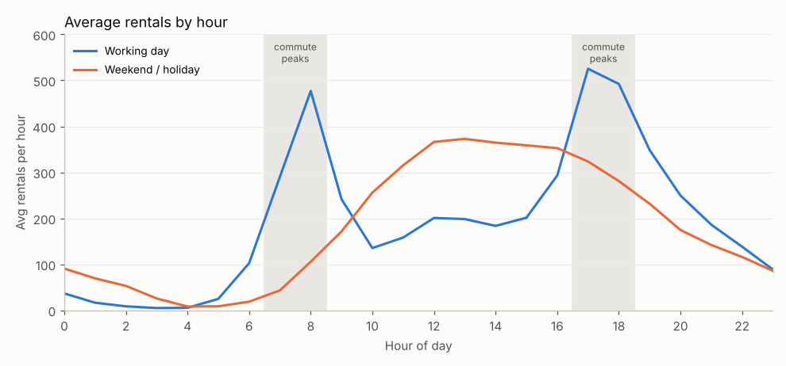
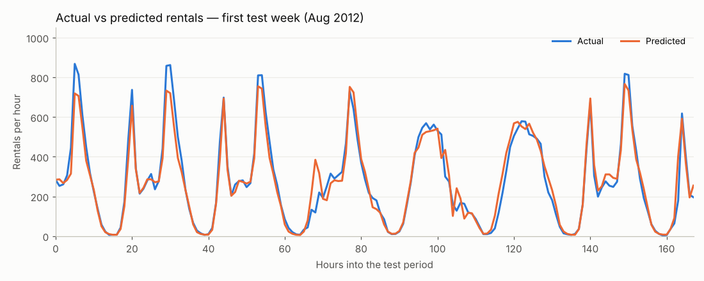

# 🚲 Bike Demand Planner

**Should a bike-sharing company buy more bikes, or use the ones it has better?**
This project analyses two years of hourly rental data, tests a hypothesis about why riders can't find bikes, trains a model that predicts hourly demand, and serves it in a Streamlit app for the operations manager.

**Author:** Sonal Priyam

---

## The problem

Riders complain they can't find a bike when they need one, yet bikes sit unused across the city. The CEO asked: *"Should we just buy more bikes?"*

## Key findings

| Question | Answer |
|---|---|
| Is the shortage about fleet size or timing? | **Timing.** On working days, commute-peak demand (7–9 am, 5–7 pm) is **2.6×** midday demand (95% CI 2.58–2.65, Wilcoxon p ≈ 10⁻⁵²). |
| Is commuting the cause? | **Yes.** On weekends and holidays the ratio falls to **0.54×**; the peak disappears without commuters. |
| Are bikes idle? | A fleet sized for each day's peak is only **~50% used** in an average daytime hour. |
| Can demand be predicted? | **Yes.** The model's average error is **≈48 rentals/hour** (R² = 0.89) on unseen months, **52% better** than a simple hour-average baseline. |

**Recommendation:** don't buy bikes first. Rebalance bikes to commuter stations before the peaks and try off-peak pricing. Revisit fleet size only if shortages continue afterwards.



---

## Project structure

```
├── app.py                        # Streamlit app
├── bike_demand_model.joblib      # trained model
├── model_metadata.json           # feature order + preprocessing rules used by the app
├── requirements.txt              # dependencies for deployment
├── README.md
│── bike_preprocessing.ipynb  # cleaning, feature engineering, time-based split
│─ hypothesis_test.ipynb     # hypothesis, statistical test, control group
│─ model_training.ipynb      # model comparison, tuning, 
└── hypothesis_chart.png
```

---

## Data

[UCI Bike Sharing Dataset](https://archive.ics.uci.edu/dataset/275/bike+sharing+dataset), hourly file: 17,379 hours from Jan 2011 to Dec 2012 (Washington D.C., Capital Bikeshare).
Weather columns are pre-normalized: `temp` = °C / 41, `atemp` = °C / 50, `hum` = % / 100, `windspeed` = km/h / 67.

### Quality checks
- No nulls or duplicates, but **165 hours are missing** from the timeline (it's a gappy time series).
- `hum = 0` in 22 rows, all on 2011-03-10 (sensor failure).
- `weathersit = 4` (heavy rain) appears in only 3 rows.
- `cnt` is right-skewed (median 142, max 977), so models are trained on `log1p(cnt)`.

## Preprocessing & features

| Step | Reason |
|---|---|
| `temp_avg = (temp + atemp) / 2`, drop `temp`, `atemp` | The two are almost identical (r = 0.99) |
| Drop `season` | Collinear with `mnth` (r = 0.83) |
| Drop `weekday` | Its effect is captured by `workingday` |
| Drop `instant`, `dteday` | Row ID and raw date; information already in `yr`, `mnth`, `hr` |
| Drop `casual`, `registered` | They add up to `cnt` → target leakage |
| Replace `hum = 0` with the training mean (0.624) | Sensor error; mean from training data only to avoid leakage |
| `low_demand_hour` = 1 for hours 23, 0–5 | Night hours average < 100 rentals vs ~250 otherwise |
| **Chronological split**: train to 7 Aug 2012, test after | Shuffling time-series data gives misleadingly good scores |

## Model

All models were compared with 5-fold `TimeSeriesSplit` cross-validation, then on the untouched test months.

| Model | MAE | RMSE | R² |
|---|---|---|---|
| **Tuned HistGradientBoosting** | **48.3** | **74.0** | **0.887** |
| HistGradientBoosting (default) | 50.4 | 76.9 | 0.878 |
| Random Forest | 52.2 | 79.5 | 0.870 |
| Baseline (hour × working-day average) | 101.6 | 144.9 | 0.568 |
| Linear Regression | 111.4 | 166.3 | 0.431 |

The most important features are **hour of day**, **working day** and **temperature**. The final model was retrained on all data before saving.



---

## The app

The operations manager enters a date, hour and weather forecast in everyday units (°C, %, km/h). The app shows:

- expected rentals for that hour
- **bikes to have ready**, including an adjustable safety buffer (default 15%)
- the busiest hour of the day and the day's total
- an hourly demand chart, downloadable as CSV
- tips such as "rebalance before this commute peak" or "night hour: good time for maintenance"

### Run locally

```bash
git clone <your-repo-url>
cd <your-repo>
python -m venv venv
source venv/bin/activate          # Windows: venv\Scripts\activate
pip install -r requirements.txt
streamlit run app.py
```

Then open http://localhost:8501.

### Deploy on Streamlit Community Cloud

1. Push this folder to a **public GitHub repository**. `app.py`, `bike_demand_model.joblib`, `model_metadata.json` and `requirements.txt` must be in the repository root.
2. Go to [share.streamlit.io](https://share.streamlit.io) and sign in with GitHub.
3. Click **Create app** → choose the repository and branch → set **Main file path** to `app.py`.
4. Open **Advanced settings** and choose **Python 3.13** (the model was trained with it).
5. Click **Deploy**. The first build installs the requirements and takes a few minutes.


---


